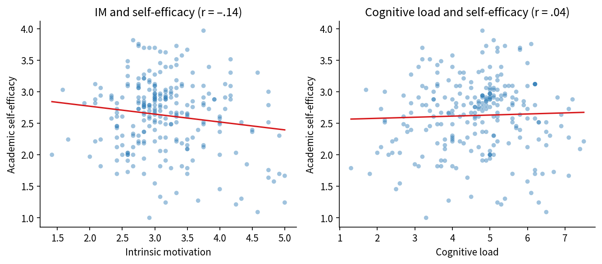
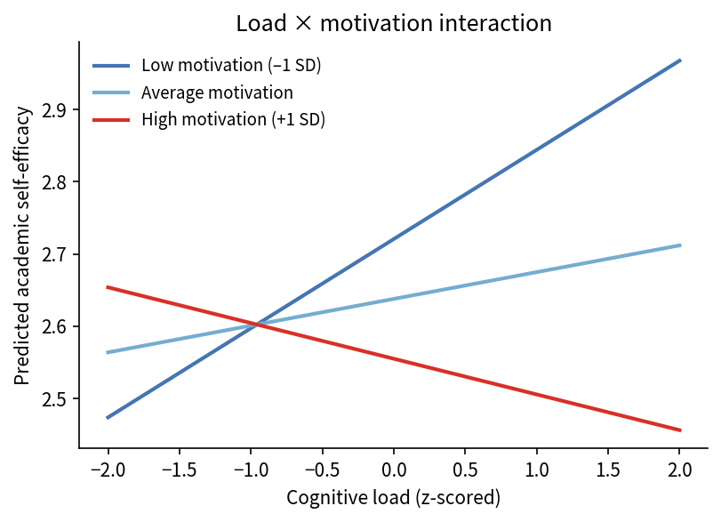

# Cognitive load, intrinsic motivation, and academic self-efficacy

Re-analysis of my undergraduate thesis data (N = 250 university students) in Python. The original analysis was done in SPSS. This repository rebuilds the scale scores from the questionnaire items and re-runs the main analyses so every number can be checked.

## Research question

Do cognitive load and intrinsic motivation predict academic self-efficacy, and does the relationship between load and self-efficacy depend on motivation?

## What the data show





Scales were reliable (α = .82–.91).

- Intrinsic motivation and academic self-efficacy were negatively related (r = –.14, p = .023).
- Cognitive load and intrinsic motivation were positively related (r = .16, p = .012).
- Cognitive load and academic self-efficacy were essentially unrelated (r = .04, p = .57).

In a multiple regression, intrinsic motivation was a significant negative predictor of self-efficacy. Cognitive load had no unique main effect. Adding the load × motivation interaction improved the model (ΔR² ≈ .036). Among students with lower motivation, higher reported load was associated with higher self-efficacy (simple slope ≈ .12, p = .015). Among highly motivated students the slope was flat or slightly negative.

These patterns are unexpected relative to the usual published findings (motivation and self-efficacy are typically positively linked). They are reported as they appear in the data rather than forced into the expected direction.

All numbers above come from the CSV files in `results/`. The scripts that produced them are in `scripts/`.

## How to run

```bash
pip install -r requirements.txt
python scripts/01_prepare.py
python scripts/02_descriptives_reliability.py
python scripts/03_correlations.py
python scripts/04_regression.py
python scripts/05_figures.py
```

Script 01 needs the raw Excel file (`Thesis Data File.xlsx`) in the parent folder or the same folder as the repo. The later scripts only need the cleaned CSV that 01 writes.

## Data availability

Item-level responses are not shared publicly because consent covered academic use only. The de-identified scale scores and the full analysis pipeline are here so every reported coefficient can be traced to the code that produced it. The dataset can be shared on reasonable request for verification.

## Honest limitations

- Cross-sectional self-report data — no causal claims are possible.
- Sample is 84 % female and mostly middle socioeconomic status.
- Perceived cognitive load is not the same as load measured in a laboratory task.
- The original thesis narrative reported the opposite direction for some of the bivariate associations. The numbers in this repository are computed directly from the item responses and match the pre-computed scale means in the original SPSS file.

## What I would do next

A pre-registered experimental study that manipulates cognitive load (for example with dual-task or time-pressure procedures) and measures both state motivation and self-efficacy would clarify directionality. A short-form version of the 33-item self-efficacy scale would also be useful; the current alpha is high but the scale is long for a single factor.

